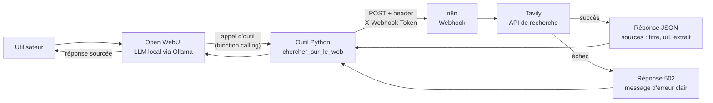

# 🔎 Agent de recherche web — LLM local + n8n + Tavily

Un agent IA qui **va chercher l'information à jour sur internet** avant de répondre, au lieu de se fier uniquement à ce que le modèle a appris.

Le LLM tourne **en local** (Ollama + Open WebUI) : aucune donnée de conversation n'est envoyée à un fournisseur de modèle.

---

## 🎯 Le problème

Un LLM local ne connaît que ses données d'entraînement. Interrogé sur l'actualité, il ne sait pas répondre… ou pire, il **invente** une réponse plausible.

## 💡 La solution

Donner au modèle un **outil de recherche web** qu'il appelle lui-même quand il en a besoin, puis l'obliger à répondre **uniquement à partir des sources trouvées**, en les citant.

---

## 🏗️ Architecture



1. L'utilisateur pose une question dans **Open WebUI**.
2. Le **LLM local** décide d'appeler l'outil `chercher_sur_le_web` et reformule la requête.
3. L'**outil Python** envoie la requête au **webhook n8n**, authentifié par token.
4. **n8n** interroge l'API **Tavily**, puis renvoie un JSON allégé : 3 sources (titre, URL, extrait).
5. Le LLM rédige une réponse en français **à partir des sources** et les cite.

---

## 🧰 Stack

| Composant | Rôle |
|---|---|
| **Ollama** | Exécution du LLM en local (`qwen2.5:3b`) |
| **Open WebUI** | Interface de chat et appel d'outils (function calling) |
| **Python** | Outil Open WebUI qui fait le lien avec n8n |
| **n8n** | Orchestration du workflow (webhook → API → réponse) |
| **Tavily** | API de recherche web pensée pour les LLM |
| **Docker** | Conteneurisation d'Open WebUI et n8n |

---

## ✅ Points clés

**Sécurité**
- Webhook protégé par un **token** envoyé dans le header `X-Webhook-Token` (réponse 403 sinon).
- Clé API Tavily stockée dans les **credentials chiffrés de n8n**, jamais dans le workflow exporté.
- Configuration de l'outil Python via les **Valves** d'Open WebUI : aucun secret dans le code.

**Robustesse**
- Requête construite avec `JSON.stringify` : une question contenant des guillemets ne casse pas le JSON.
- Timeout de 15 s et **3 tentatives automatiques** sur l'appel Tavily.
- Branche d'erreur dédiée : en cas d'échec, n8n renvoie une **réponse 502 explicite** au lieu d'un échec silencieux.
- Côté Python, chaque erreur est distinguée (timeout, n8n injoignable, token invalide, échec Tavily) pour que le LLM puisse expliquer le problème.

**Fiabilité des réponses**
- Le modèle reçoit uniquement les **sources** (pas de synthèse intermédiaire) et doit les citer.
- Si les sources ne contiennent pas la réponse, le prompt système l'oblige à **dire qu'il ne sait pas**.

---

## 📁 Structure du dépôt

```
.
├── README.md
├── .env.example                 # Variables à renseigner (sans valeurs réelles)
├── .gitignore
├── workflow/
│   └── web-search.json          # Workflow n8n à importer
├── openwebui-tool/
│   └── web_search_tool.py       # Outil à coller dans Open WebUI
└── docs/
    └── ...                      # Captures d'écran
```

---

## 🚀 Installation

### Prérequis
- [Ollama](https://ollama.com) avec un modèle compatible appel d'outils : `ollama pull qwen2.5:3b`
- [Open WebUI](https://github.com/open-webui/open-webui) et [n8n](https://n8n.io) (par exemple via Docker)
- Une clé API [Tavily](https://tavily.com) (offre gratuite disponible)

### 1. Configurer n8n
1. Importer `workflow/web-search.json`.
2. Créer deux credentials de type **Header Auth** :
   - **Tavily API** → Name : `Authorization` · Value : `Bearer tvly-VOTRE_CLE`
   - **Webhook Token** → Name : `X-Webhook-Token` · Value : un token aléatoire
3. Associer **Webhook Token** au nœud Webhook et **Tavily API** au nœud HTTP Request.
4. **Publier** le workflow (l'URL de production `/webhook/...` ne répond que si le workflow est publié).

Générer un token aléatoire sous Windows (PowerShell) :
```powershell
[guid]::NewGuid().ToString() + [guid]::NewGuid().ToString()
```

### 2. Configurer Open WebUI
1. **Espace de travail → Outils → +** : coller le contenu de `openwebui-tool/web_search_tool.py`.
2. Dans les **Valves** de l'outil (icône ⚙️) :
   - `N8N_WEBHOOK_URL` : `http://host.docker.internal:5678/webhook/VOTRE_PATH`
   - `N8N_WEBHOOK_TOKEN` : le même token que dans n8n
3. Dans les réglages du modèle :
   - rattacher l'outil au modèle (**Outils**) ;
   - **Appel de fonction** : `Natif` ;
   - **Température** : `0.3` ;
   - **Prompt système** :

```
Tu es un assistant qui répond en français.
Pour toute question factuelle ou d'actualité, utilise TOUJOURS l'outil chercher_sur_le_web, y compris pour les questions de suivi.
Réponds uniquement à partir des sources renvoyées par l'outil.
Si les sources ne contiennent pas la réponse, dis clairement que tu ne sais pas.
Rédige une réponse fluide et synthétique, et cite les URL des sources utilisées.
```

> 💡 Open WebUI tourne dans Docker : utiliser `host.docker.internal` et non `localhost` pour joindre n8n depuis le conteneur.

### 3. Tester
Dans une nouvelle conversation :
```
Qui a remporté le Ballon d'Or féminin 2026 ?
```
Une exécution doit apparaître dans l'onglet **Executions** de n8n, et la réponse doit citer ses sources.

---

## 🧪 Ce que les tests m'ont appris

- **Un petit modèle ne pense pas toujours à utiliser l'outil.** Sur une question de suivi, `qwen2.5:3b` a répondu de mémoire… et a inventé la réponse. Correction : un prompt système qui impose l'outil et l'appel de fonction en mode natif.
- **Même une synthèse automatique peut déformer ses sources.** Le champ `answer` renvoyé par Tavily contenait une erreur absente des sources. Correction : ne transmettre au modèle que les sources brutes.
- **Sur CPU, chaque token compte.** Sans carte graphique, la lecture du prompt tourne autour de 12 tokens/s. Réduire les résultats (3 sources, extraits de 500 caractères) divise fortement le temps de réponse.

---

## 🗺️ Évolutions prévues

- [ ] **Agent de prospection B2B** : à partir d'un nom d'entreprise, recherches ciblées (actualité, recrutements, levées de fonds), extraction des signaux d'affaires par le LLM, score de qualification et envoi dans un CRM (HubSpot).
- [ ] **Journalisation** des requêtes (question, nombre de sources, temps de réponse, succès/échec) pour mesurer et améliorer la fiabilité.
- [ ] **Modèle interchangeable** : même outil et même workflow avec un modèle cloud (performance) ou local (confidentialité), sans changer de code.
- [ ] Validation de la requête en entrée du webhook (requête vide → 400).

---

## 👤 Auteur

**Jonatan NSUALU** — Développeur full stack, en Bac+5 Expert en Architecture et Développement Logiciel (ENI Rennes)
GitHub : [@JonatanNs](https://github.com/JonatanNs)